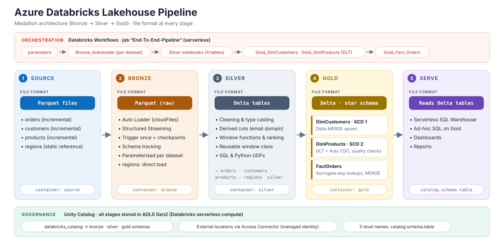
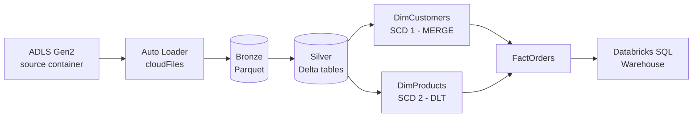
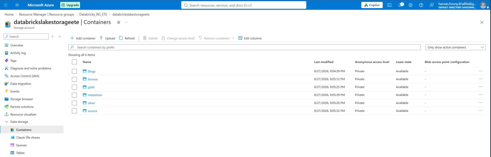
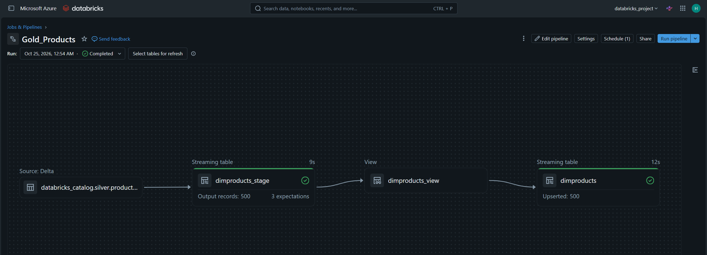
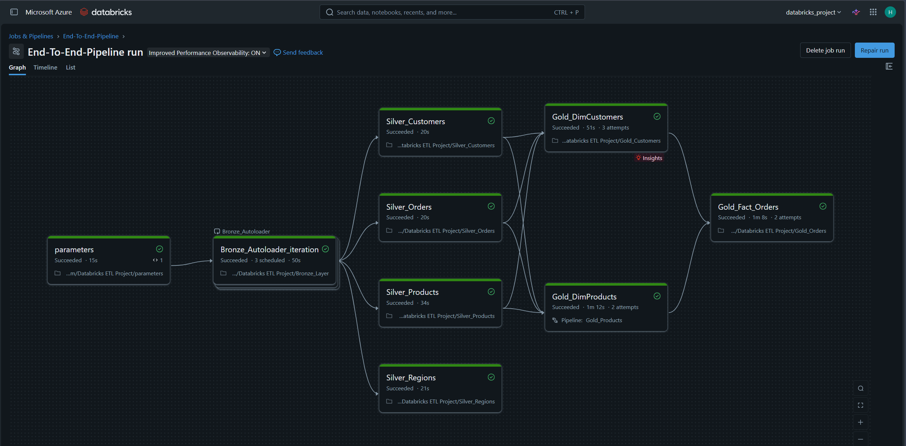

# Azure Databricks Lakehouse: End-to-End Data Engineering Project


A Lakehouse pipeline on **Azure Databricks** that ingests raw files from **ADLS Gen2**, refines them through a **Medallion (Bronze → Silver → Gold)** architecture, and publishes a **star schema** for analytics. Governance is handled by **Unity Catalog**, history tracking by **SCD Type 1 and Type 2** dimensions, and execution by a **Databricks Workflows** job.



## Table of contents

- [Highlights](#highlights)
- [Architecture](#architecture)
- [Tech stack](#tech-stack)
- [Repository structure](#repository-structure)
- [Pipeline walkthrough](#pipeline-walkthrough)
- [Data model](#data-model)
- [Getting started](#getting-started)
- [Screenshots](#screenshots)
- [Design notes and roadmap](#design-notes-and-roadmap)

## Highlights

| Capability | Implementation |
| --- | --- |
| Incremental ingestion | Auto Loader (`cloudFiles`) with checkpointing and schema tracking, run once per dataset |
| Metadata-driven runs | A `parameters` notebook publishes a dataset list; the workflow loops over it with a *for each* task |
| Medallion layering | Raw Parquet in Bronze, cleaned Delta tables in Silver, star schema in Gold |
| Slowly changing dimensions | `DimCustomers` as SCD Type 1 (Delta `MERGE`), `DimProducts` as SCD Type 2 (DLT Auto CDC) |
| Data quality | DLT expectations on the product stream (`expect_or_fail`, `expect_or_drop`) |
| Governance | Unity Catalog catalog, schemas and external locations, with access through a managed identity |
| Reusable logic | Unity Catalog SQL and Python UDFs, and a reusable window-function helper class |
| Orchestration | Serverless Databricks Workflow with an explicit task DAG |

## Architecture

The pipeline reads incremental Parquet files for `orders`, `customers` and `products` from the `source` container. Auto Loader lands them in `bronze`, Silver notebooks clean them into Delta tables, and Gold notebooks build two dimensions and a fact table. The static `regions` reference data is loaded directly rather than streamed. The full component-level description is in [docs/architecture.md](docs/architecture.md).



## Tech stack

| Area | Technology |
| --- | --- |
| Cloud | Microsoft Azure (UK South) |
| Storage | Azure Data Lake Storage Gen2 (hierarchical namespace) |
| Processing | Azure Databricks, PySpark, Spark Structured Streaming |
| Table format | Delta Lake |
| Declarative pipelines | Delta Live Tables / Lakeflow Declarative Pipelines |
| Governance | Unity Catalog, Access Connector for Azure Databricks (managed identity) |
| Orchestration | Databricks Workflows (serverless) |
| Serving | Databricks SQL Warehouse |

## Repository structure

```text
.
├── notebooks/
│   ├── bronze/          # parameters.py, Bronze_Layer.py (Auto Loader ingestion)
│   ├── silver/          # Silver_Customers / Orders / Products / Regions
│   └── gold/            # Gold_Customers (SCD1), Gold_Products (SCD2, DLT), Gold_Orders (fact)
├── data/
│   └── sample/          # Sample Parquet files: first and second loads for orders, customers and products; one static file for regions
├── docs/
│   ├── architecture.md  # Component-level architecture and design decisions
│   ├── data-model.md    # Layer schemas and star schema
│   ├── setup-guide.md   # Step-by-step environment setup
│   └── images/          # Architecture diagram and screenshots
├── exports/
│   └── Databricks ETL Project.dbc   # Importable Databricks archive of the notebooks
└── README.md
```

## Pipeline walkthrough

| Stage | Notebook | What it does |
| --- | --- | --- |
| Orchestration | `bronze/parameters` | Publishes the dataset list (`orders`, `customers`, `products`) as a job task value |
| Bronze | `bronze/Bronze_Layer` | Streams each dataset with Auto Loader into the `bronze` container, trigger once |
| Silver | `silver/Silver_Customers` | Drops `_rescued_data`, derives the email domain, builds `full_name`, writes Delta |
| Silver | `silver/Silver_Orders` | Adds the order year, demonstrates ranking and window functions, writes Delta |
| Silver | `silver/Silver_Products` | Registers SQL and Python UDFs, adds `update_ts`, writes Delta |
| Silver | `silver/Silver_Regions` | Reads the `bronze.regions` table, drops `_rescued_data`, writes Delta |
| Gold | `gold/Gold_Customers` | Deduplicates, assigns surrogate keys, applies an SCD Type 1 `MERGE` |
| Gold | `gold/Gold_Products` | DLT pipeline with expectations and an SCD Type 2 Auto CDC flow |
| Gold | `gold/Gold_Orders` | Joins dimension keys onto orders and upserts `FactOrders` |

Workflow dependency order: `parameters` → `Bronze_Autoloader` (for each) → four Silver tasks → `Gold_DimCustomers` and `Gold_DimProducts` → `Gold_Fact_Orders`.

## Data model

| Table | Layer | Type | Notes |
| --- | --- | --- | --- |
| `orders_silver`, `customers_silver`, `products_silver`, `regions_silver` | Silver | Delta | Cleaned copies of the Bronze data |
| `DimCustomers` | Gold | SCD Type 1 | Surrogate key `DimCustomerKey`, `create_date`, `update_date` |
| `DimProducts` | Gold | SCD Type 2 | Built by DLT; history tracked on `update_ts` |
| `FactOrders` | Gold | Fact | Keyed by `order_id`, `DimCustomerKey`, `DimProductKey` |

Details and column-level notes are in [docs/data-model.md](docs/data-model.md).

## Getting started

**Prerequisites:** an Azure subscription, permission to create a Databricks workspace and role assignments, and a Unity Catalog metastore.

1. Provision the resource group, ADLS Gen2 account, five containers, Access Connector and Databricks workspace.
2. Configure Unity Catalog: external locations, the `databricks_catalog` catalog and the `bronze`, `silver`, `gold` schemas.
3. Upload the files from [`data/sample`](data/sample) to the `source` container.
4. Import the notebooks from [`notebooks`](notebooks) (or the archive in [`exports`](exports)), create the DLT pipeline and the workflow, then run it.

The complete walkthrough, including the exact resource names, is in [docs/setup-guide.md](docs/setup-guide.md).

> The notebooks currently reference the storage account `databrickslakestorageete` directly. If you use a different account name, update the `abfss://` paths first (see [Design notes](#design-notes-and-roadmap)).

## Screenshots

| Azure resources | ADLS containers |
| --- | --- |
|  |  |

| Workspace notebooks | DLT pipeline for `DimProducts` |
| --- | --- |
|  |  |

**Workflow run: `End-To-End-Pipeline`**



## Design notes and roadmap

This project is a learning and portfolio build, and a few simplifications are worth knowing about:

- Storage account name, catalog name and container paths are hard-coded in the notebooks. Moving them to job parameters or a shared config notebook is the first planned improvement.
- `Gold_Orders` currently uses `product_id` as `DimProductKey`. Because `DimProducts` is SCD Type 2, a lookup on the current version's surrogate key would be more correct.
- `DimCustomers` surrogate keys use `monotonically_increasing_id()` offset by the current maximum. A Delta identity column is a more robust alternative.
- Silver tables are fully overwritten on each run, which suits the sample data volume.
