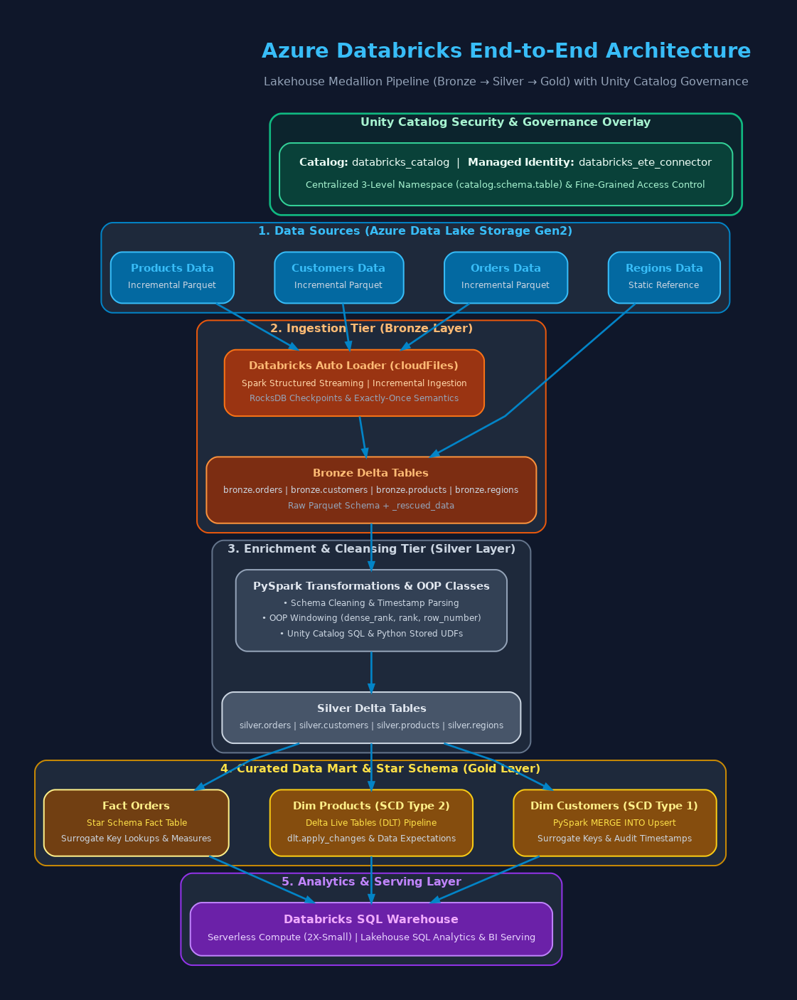
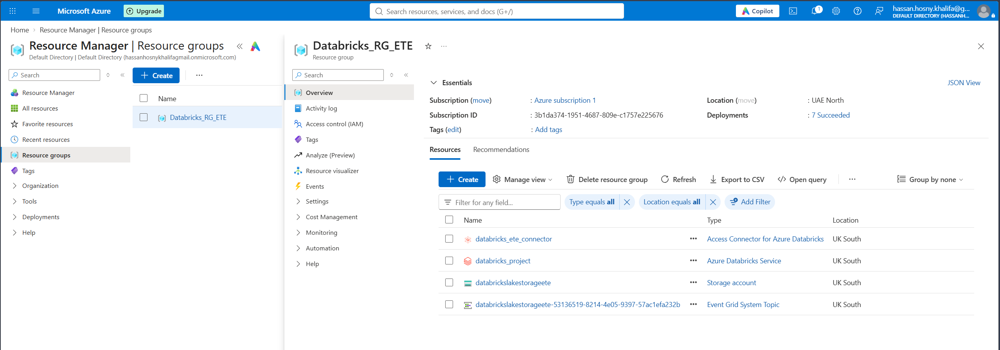
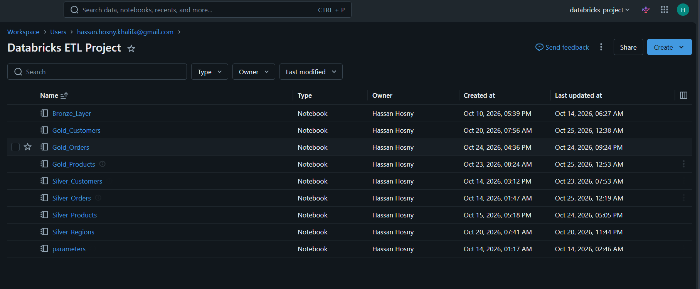

# Azure Databricks End-to-End Data Engineering Project

An enterprise-grade, production-ready Lakehouse solution built on **Azure Databricks**, **Azure Data Lake Storage Gen2 (ADLS Gen2)**, **Unity Catalog**, and **Delta Live Tables (DLT)**. This project demonstrates end-to-end data engineering best practices—from infrastructure provisioning and Auto Loader ingestion to Delta Lake Medallion architecture, SCD Type 1 & Type 2 tracking, and automated orchestration via Databricks Workflows.

---

## Project Architecture

```
[ ADLS Gen2 Source ] 
       │
       ▼ (Auto Loader / cloudFiles)
[ Bronze Layer ] ────> (Raw Parquet Files & Checkpoints)
       │
       ▼ (PySpark Data Cleaning & UDFs)
[ Silver Layer ] ────> (Delta Tables: Orders, Customers, Products, Regions)
       │
       ├──────────────────────────────┐
       ▼ (PySpark MERGE INTO - SCD1)  ▼ (Delta Live Tables - SCD2)
[ Gold: Dim Customers ]        [ Gold: Dim Products ]
       │                              │
       └──────────────┬───────────────┘
                      ▼ (Surrogate Key Mapping & MERGE)
             [ Gold: Fact Orders ]
                      │
                      ▼
        [ Databricks SQL Warehouse ]
```

The architecture adheres to the **Medallion Pattern** (Bronze → Silver → Gold) governed by **Unity Catalog** and orchestrated via **Databricks Workflows**.

## Architecture Diagram


---

## Tech Stack & Infrastructure

- **Cloud Platform**: Microsoft Azure
- **Resource Group**: `Databricks_RG_ETE`
- **Databricks Workspace**: `databricks_project` (Region: UK South)
- **Data Governance**: Unity Catalog with `databricks_ete_connector` (Access Connector for Azure Databricks via Managed Identity)
- **Storage Account**: `databrickslakestorageete` (ADLS Gen2)
- **Container Architecture**:
  - `source`: Landing area for raw incoming data files
  - `bronze`: Ingested data landing zone
  - `silver`: Standardized and cleaned Delta tables
  - `gold`: Curated star schema data mart
  - `metastore`: Unity Catalog metastore storage root
- **Compute & Orchestration**: Databricks Serverless Compute & Workflows
---


---

## Workspace & Pipeline Structure

### Workspace Location
`/Workspace/Users/hassan.hosny.khalifa@gmail.com/Databricks ETL Project`

### Notebooks & ETL Components
1. **`parameters`**: Dynamic widget parameters and workflow task values propagation.
2. **`Bronze_Layer`**: Streaming ingestion via **Spark Auto Loader** (`cloudFiles`) with RocksDB state stores for idempotent, exactly-once processing.
3. **`Silver_Customers`**: Data cleaning, email domain extraction, and schema standardization.
4. **`Silver_Orders`**: Timestamp conversions, line item calculations, and partitioning.
5. **`Silver_Products`**: Price formatting, categorization, and metadata enrichment.
6. **`Silver_Regions`**: Processing static lookup dataset.
7. **`Gold_Customers`**: **SCD Type 1** dimension table built with PySpark Delta `MERGE INTO` and surrogate key generation.
8. **`Gold_Products`**: **SCD Type 2** dimension pipeline powered by **Delta Live Tables (DLT)**.
9. **`Gold_Orders`**: Fact table linking Gold dimensions via surrogate keys and numeric measures.

---

---

## Delta Live Tables (DLT) Pipeline: `Gold_Products`

The `Gold_Products` pipeline handles historical product changes (SCD Type 2) declaratively:

1. **Source**: `databricks_catalog.silver.products`
2. **Stage (`dimproducts_stage`)**: Streaming table with 3 data quality expectations (`@dlt.expect_all_or_drop`).
3. **View (`dimproducts_view`)**: Transformation view preparing staging data for upserts.
4. **Target (`dimproducts`)**: Target streaming table applying changes via `dlt.apply_changes(stored_as_scd_type=2)` to automatically maintain effective dates and active flags.
---

---

## Orchestration DAG: `End-To-End-Pipeline`

Automated end-to-end execution managed by a Serverless **Databricks Workflow**:

---

---

## 📋 Step-by-Step Setup Guide

### Step 1: Provision Azure Infrastructure
1. Create Resource Group `Databricks_RG_ETE`.
2. Provision Storage Account `databrickslakestorageete` (ADLS Gen2 with Hierarchical Namespace enabled).
3. Create 5 containers: `source`, `bronze`, `silver`, `gold`, `metastore`.
4. Create Access Connector `databricks_ete_connector` and assign `Storage Blob Data Contributor` role on the storage account.
5. Deploy Azure Databricks Workspace `databricks_project`.

### Step 2: Configure Unity Catalog Governance
1. Create an External Location pointing to `abfss://<container-name>@<storage-account-name>.dfs.core.windows.net/` using `<access-connector-name>`.

   Example: `abfss://metastore@mystorageaccount.dfs.core.windows.net/`
2. Create Catalog Example: `databricks_catalog` and schemas: `bronze`, `silver`, `gold`.

### Step 3: Import & Execute ETL Notebooks
1. Import notebooks into `/Workspace/Users/<your-email>/Databricks ETL Project/`.
2. Configure DLT Pipeline `Gold_Products` pointing to `Gold_Products` notebook code.
3. Create Databricks Workflow `End-To-End-Pipeline` connecting tasks as per the DAG structure above.
4. Run pipeline and query Gold tables via Databricks SQL Warehouse.

