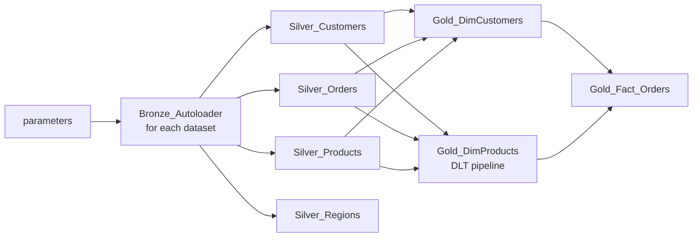

# Architecture

## Overview

The solution follows the Medallion pattern on Azure Databricks. Each layer lives in its own ADLS Gen2 container, is registered in Unity Catalog, and is produced by a dedicated set of notebooks that are chained together by a Databricks Workflows job.

## Components

| Component | Name | Purpose |
| --- | --- | --- |
| Resource group | `Databricks_RG_ETE` | Holds all Azure resources |
| Workspace | `databricks_project` (UK South) | Notebooks, jobs, pipelines and SQL warehouse |
| Storage account | `databrickslakestorageete` | ADLS Gen2 with hierarchical namespace |
| Containers | `source`, `bronze`, `silver`, `gold`, `metastore` | One per layer, plus the Unity Catalog metastore root |
| Access Connector | `databricks_ete_connector` | Managed identity used by Unity Catalog to reach storage |
| Catalog | `databricks_catalog` | Schemas `bronze`, `silver`, `gold` |
| Compute | Serverless | Jobs, DLT pipeline and SQL warehouse |

## Layers

### Source

Incremental Parquet drops for `orders`, `customers` and `products`, plus a static `regions` reference file, are placed in the `source` container. Sample files for two successive loads are in `data/sample`.

### Ingest and Bronze

`Bronze_Layer` reads each dataset with Auto Loader (`cloudFiles`, Parquet) as a stream and writes it as Parquet to the `bronze` container with `trigger(once=True)`. The schema location and checkpoint live under `bronze/checkpoint_<dataset>/`, which makes reruns idempotent: files already processed are not read again. The dataset name arrives through a notebook widget, so one notebook serves every dataset.

`Regions` is static reference data and is registered as the table `databricks_catalog.bronze.regions` instead of being streamed.

### Silver

Each Silver notebook reads from Bronze, removes the `_rescued_data` column and applies dataset-specific logic, then writes a Delta table to the `silver` container and registers it in Unity Catalog (`*_silver`).

- **Customers**: derive the email domain, build `full_name`.
- **Orders**: derive the year; includes ranking and window-function examples and a reusable `WindowFunctions` helper class.
- **Products**: SQL and Python UDFs registered in Unity Catalog (`discount_func`, `upper_func`), and an `update_ts` column used as the SCD2 sequence.
- **Regions**: pass-through cleanup of the reference table.

### Gold

- **DimCustomers (SCD Type 1)**: deduplicates on `customer_id`, separates new from existing records, assigns surrogate keys, then runs a Delta `MERGE`. An `init_load_flag` widget switches between first load and incremental load.
- **DimProducts (SCD Type 2)**: a DLT pipeline with a staging streaming table carrying data-quality expectations, a streaming view, and an Auto CDC flow keyed on `product_id` and sequenced by `update_ts`, stored as SCD Type 2.
- **FactOrders**: joins orders to the dimension keys and upserts into a Delta table with `MERGE`.

### Serving

A Databricks SQL Warehouse queries the Gold tables for ad-hoc analysis and BI.

## Orchestration

The `End-To-End-Pipeline` job runs on serverless compute:

## Governance and security

- Storage access goes through the Access Connector's managed identity, granted *Storage Blob Data Contributor* on the storage account. No keys or secrets are stored in notebooks.
- Unity Catalog provides the three-level namespace (`catalog.schema.table`) and the place to apply fine-grained permissions.
- External locations map each container to the connector.

## Design notes and known limitations

| Topic | Current behaviour | Suggested improvement |
| --- | --- | --- |
| Configuration | Storage account and catalog names are hard-coded in notebooks | Job parameters or a shared config notebook |
| Product key in fact | `DimProductKey` is set to `product_id` | Look up the surrogate key of the current SCD2 row |
| Customer surrogate key | `monotonically_increasing_id()` plus current max | Delta identity column |
| Silver writes | Full overwrite each run | Incremental `MERGE` for large volumes |
| Testing | None yet | Unit tests for transformation functions |
| Deployment | Manual import | Databricks Asset Bundles and CI/CD |
