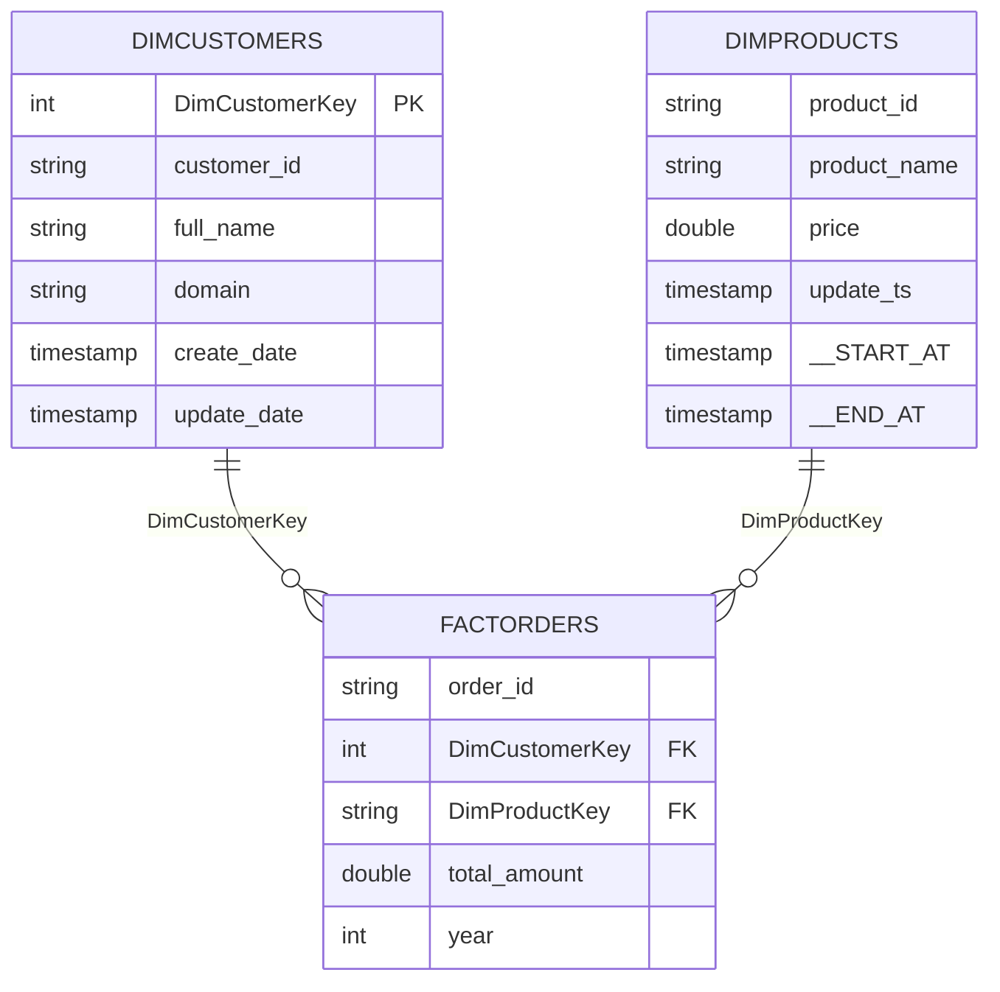

# Data model

## Datasets

| Dataset | Load pattern | Sample files |
| --- | --- | --- |
| `orders` | Incremental | `orders_first.parquet`, `orders_second.parquet` |
| `customers` | Incremental | `customer_first.parquet`, `customers_second.parquet` |
| `products` | Incremental | `products_first.parquet`, `products_second.parquet` |
| `regions` | Static reference | `regions.parquet` |

The two-file pattern lets you run the pipeline once, add the second file, and run it again to see incremental ingestion, SCD Type 1 updates and SCD Type 2 history.

## Layer by layer

| Layer | Location | Format | Tables |
| --- | --- | --- | --- |
| Bronze | `abfss://bronze@<account>.dfs.core.windows.net/<dataset>/` | Parquet | Raw files plus `_rescued_data`; `bronze.regions` is a registered table |
| Silver | `abfss://silver@<account>.dfs.core.windows.net/<dataset>/` | Delta | `silver.orders_silver`, `silver.customers_silver`, `silver.products_silver`, `silver.regions_silver` |
| Gold | `abfss://gold@<account>.dfs.core.windows.net/<table>/` | Delta | `gold.dimcustomers`, `gold.dimproducts`, `gold.factorders` |

## Silver transformations

| Table | Changes versus Bronze |
| --- | --- |
| `customers_silver` | `_rescued_data` dropped; `domain` derived from `email`; `first_name` and `last_name` merged into `full_name` |
| `orders_silver` | `_rescued_data` dropped; `year` derived from `order_date` |
| `products_silver` | `_rescued_data` dropped; `discounted_price` (10 percent discount UDF) and `update_ts` added |
| `regions_silver` | `_rescued_data` dropped |

## Gold star schema

The column lists above show the key and tracking columns the notebooks create explicitly; the remaining business columns come from the source files. `__START_AT` and `__END_AT` are added by DLT's SCD Type 2 handling.

## Slowly changing dimensions

| Dimension | Type | Mechanism | Behaviour on change |
| --- | --- | --- | --- |
| `DimCustomers` | SCD Type 1 | Delta `MERGE` on `DimCustomerKey` | Existing row overwritten; `update_date` refreshed |
| `DimProducts` | SCD Type 2 | DLT Auto CDC, key `product_id`, sequence `update_ts` | New row version inserted; previous version closed with an end timestamp |

## Data-quality rules (DimProducts staging)

| Rule | Condition | Action on violation |
| --- | --- | --- |
| `valid_product_id` | `product_id IS NOT NULL` | Fail the update |
| `valid_product_name` | `product_name IS NOT NULL` | Drop the row |
| `valid_price` | `price > 0` | Drop the row |
